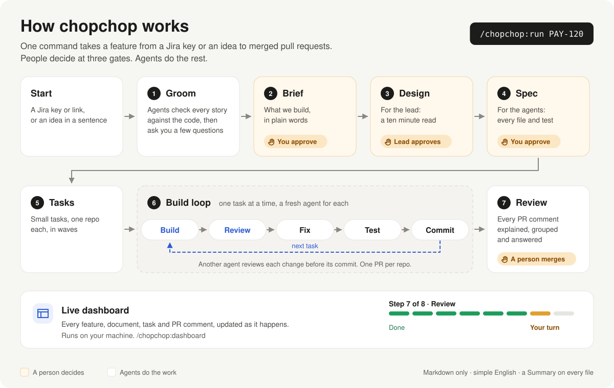

# chopchop

A Claude Code plugin that takes a feature from a Jira key, or a one-line idea, to merged PRs.
People decide what to build and approve it. Agents read the code, build, review, test and fix.

<picture>
  <source media="(prefers-color-scheme: dark)" srcset="docs/images/how-it-works-dark.svg">
  
</picture>

Start with one command, from a tracker key or from an idea:

```bash
/chopchop:run PAY-120
/chopchop:run let customers ask for a refund
```

- **One command.** `/chopchop:run` finds the next step and does it. It stops only where a person
  must decide.
- **Three yeses.** You approve the brief. The lead approves the design. You approve the spec.
- **Agents do the loop.** Each task gets a fresh agent to build it and another to review it,
  then fixes, tests and one commit. One PR per repo.
- **A live dashboard.** Every feature, every document and every task, updated as it happens.
- **Review comments explained.** Each PR comment in simple English: real problem or false
  alarm, the fix, what it touches, and a reply you can send.
- **Markdown only, simple English, a Summary on top of every file.**

chopchop holds no logins and talks to no tracker or git host by itself. It uses what your
team already has in the session: a connected tool (an MCP server), a CLI that is already
logged in, or a file you give it. If there is nothing, it asks you.

## Install

In Claude Code:

```bash
/plugin marketplace add buminduyasith/chopchop
/plugin install chopchop@chopchop
```

From a shell: `claude plugin marketplace add buminduyasith/chopchop`, then
`claude plugin install chopchop@chopchop`. Add `--scope project` to share it with everyone
who opens a repo.

### Update

| You type | What it does |
| --- | --- |
| `/chopchop:update` | Gets the latest version. Then run `/reload-plugins`. |
| `/chopchop:update --auto on` | Lets Claude Code update chopchop by itself from now on. |

## Quick start

| You type | What happens |
| --- | --- |
| `/chopchop:init` | Once per team. Asks where to keep files, the base branch, the repos and their code style. |
| `/chopchop:run PAY-120` | Gets the stories, checks them against the code, asks you a few questions, writes the brief. Then it waits for your yes. |
| `approve` | The design gets written. It waits for the lead. |
| `approve Asha` | The spec gets written. It waits for your yes. |
| `approve` | Tasks are cut and the build loop runs. One PR per repo at the end. |
| `/chopchop:comments` | When reviewers comment: every comment explained, grouped and planned. |
| `/chopchop:run` | Any time, in any chat: carries on from where things stood. |

Everything is saved in files, so you can close the chat at any point.

## The steps

| Step | What happens | Who says yes |
| --- | --- | --- |
| **Groom** | Agents check each story against the real code: does it fit, what it touches, what it clashes with, the work nobody wrote down. Then a short interview: a few questions with answers to pick. What you do not know becomes a ready-to-paste list for the BA. | |
| **Brief** | What we build, in simple English, on one page. | you |
| **Design** | For the lead, a 10 minute read: the parts, the main flow, the real choices, the risks. Every claim cites the code. | the lead |
| **Spec** | For the agents: the rules with examples, every file, the code to copy, every test by name. | you |
| **Tasks** | Small tasks, one repo each, in waves. | |
| **Build** | Per task: a fresh agent builds, another reviews, fixes are made, checks run, one commit. | |
| **Review** | PR comments are explained, grouped by cause, fixed together and answered. | reviewers merge |

**Jira stories or your own idea?** Stories from the tracker are **locked**: chopchop never
changes what the BA wrote, and every idea it has becomes a question. Your own idea is **open**:
it suggests better ways and you pick.

## Commands

### `/chopchop:run`

| You type | What it does |
| --- | --- |
| `PAY-120`, a tracker link, or an idea in words | Starts the feature and takes it as far as it can go. |
| a feature (`1`, `PAY-120`, `refunds`) | Carries on with that feature. |
| (nothing) | Carries on. With several features, it lists them and who each waits for. |
| `approve`, `approve Asha` | Your yes at a gate. For the design: who approved it. |
| notes ("change the limit to 14 days") | Changes the document at the open gate, then asks again. |
| `--auto` | No interview and no design questions. Guesses become listed assumptions. The three yeses still need a person. |
| `--list` | Every feature: the step it is on and who it waits for. |

### `/chopchop:dashboard`

| You type | What it does |
| --- | --- |
| (nothing) | Starts the dashboard and opens it. `run` starts it for you. |
| `--stop` | Stops it. |
| `--status` | Says if it runs, and where. |

- **Home:** one card per feature: a "Your turn" pill when it waits on you, one plain sentence on where it
  stands, its 8 steps as small bars, "6 of 6 tasks built", and its Summary. Filter by text, step, or who it
  waits for.
- **A feature:** the title and one sentence such as "Built and pushed. It's waiting for you to open the pull
  requests", then a progress card ("Step 7 of 8 · Review" with 8 bars), then what you do next.
- **Your turn:** when you must act, a card with numbered steps and any command in a bar with a Copy button.
- **Pull requests:** while a feature is in review, one row per repo with its state and a button: "Open pull
  request", or "Create pull request" when the branch is only pushed (it opens your git host's create page with
  the branches filled in; GitHub, GitLab, Bitbucket and Azure DevOps).
- **Tabs:** Overview, Brief, Design, Spec, Files, Tasks, Review and Activity. A check marks an approved document.
  **Compare** shows the design and the spec side by side, each the full height of the window.
- **Files:** for the tech spec, every file it will add, change or delete, as a folder tree per repo, like your
  editor's file explorer: green A for new, amber M for changed, red D for deleted. Click a file to see why it
  changes and which task changes it.
- **Diagrams:** each in its own card, drawn in the page's colours. **See full view** shows the whole diagram
  fitted to the window, with zoom and drag.
- **Code:** coloured like VS Code.
- **Tasks:** a board. Click a task to read it, with its diagrams.
- **Live:** it updates by itself when a file changes.
- **Looks:** dark by default with a light toggle, Lexend and JetBrains Mono, and contrast checked in both
  themes. The rules are in `docs/ui-style-guide.md`.

It runs on your machine only (`127.0.0.1`), reads the `_chopchop` folder, and never changes
anything. It loads two fonts from Google Fonts and, only on pages that need them, the diagram and code
colour scripts from a pinned link. No file from your workspace is ever sent anywhere.

### `/chopchop:comments`

| You type | What it does |
| --- | --- |
| (nothing), or a feature | Finds the feature's PRs, reads every review comment, and explains each. |
| a PR link | The same for one PR, even with no chopchop feature. |
| `--fix` | Fixes the comments you chose, one group at a time, with a review before each commit. |
| `--watch` | Keeps listening until the PRs are merged, and explains new comments as they come. |
| `--replies` | Shows the reply drafts. It posts them only after your yes. |

For each comment you see:

| | |
| --- | --- |
| **In plain words** | what the reviewer means |
| **Verdict** | a real problem, a false alarm, fair but not for this PR, a question |
| **Why** | what in the code makes chopchop think so |
| **Priority** | high, medium, low |
| **Similar** | other comments with the same cause, in any PR or repo. They are fixed together, so one fix never undoes another. |
| **Fix and impact** | what would change, and what else it touches |
| **Reply** | a short, polite reply, ready to send |

Everything is on the dashboard's Review tab and in `comments.md`.

### The single steps

`run` uses these. Each also works on its own.

| Command | What it does |
| --- | --- |
| `/chopchop:init` | Sets up `_chopchop/chopchop.yaml`. Safe to run again. |
| `/chopchop:learn` | Maps every repo: APIs, events, tables, owners, patterns, how they connect. Later runs read only what changed. |
| `/chopchop:groom <key, link, idea or feature>` | Research, interview, BA questions, the brief. `--auto` asks nothing. |
| `/chopchop:stories PAY-120` | Only copies an epic and its stories in. `-rs 1` fetches again and explains what changed. |
| `/chopchop:design <feature>` | Writes `design.md`. `"lead's notes"` changes it. `--pick 2=B` changes one choice. `--approve "Asha"` records the lead's yes. |
| `/chopchop:spec <feature>` | Writes `spec.md` and `spec.json`. `--approve "Name"` records your yes. `--status` shows what is planned, built and proved. |
| `/chopchop:check <feature>` | Compares the design with the requirements: conflicts, gaps, extras, questions. |
| `/chopchop:tasks <feature>` | Cuts the spec into tasks and makes the feature branch after your yes. |
| `/chopchop:auto <feature>` | The build loop. `--resume` carries on. `--status` shows the run. `--retry T02` restarts a stopped task. `--wave` pauses after each wave. |
| `/chopchop:code T02` | One task by hand, up to an open PR. |
| `/chopchop:review` | A fresh review of your pending changes, in any git repo. `--fix` applies the safe fixes. |
| `/chopchop:diagram` | Draws or fixes the design's two pictures. |
| `/chopchop:update` | Updates the plugin. |

### The build loop

For each task, in order:

1. **Pick** the next task whose earlier tasks are done.
2. **Build** it with a fresh agent: tests first, then the code.
3. **Check** it: build, lint and tests.
4. **Review** the change with a second fresh agent that did not write it.
5. **Sort** the findings into fix now, park, or stop.
6. **Fix** what is in scope, at most 2 rounds.
7. **Commit** it, then go to the next task.

- **Fresh context every task.** Each task gets a new builder and a new reviewer. The chat keeps
  a few lines per task, and the run lives in `work/auto.json`, so a new chat carries on.
- **Review before commit.** The reviewer reads the pending change and has not seen how it was
  made.
- **The spec decides.** Each finding is sorted. Fix now: bugs, lint, names, missing tests,
  style rules. Park: another approach, a changed contract, a new library. Parked ideas are
  never applied: they go in the PR text for the lead. Stop: something a person must decide.
- **Few PRs.** One build branch per repo, one commit per task, one PR per repo into the
  feature branch. A reviewer can go commit by commit.
- **It stops and asks** when the spec would have to change, a check keeps failing, or a task
  cannot be built as written.

## Rules for every file

1. **Markdown only.** The dashboard shows it nicely. A code block is only for real code, coloured like VS Code.
   Trees, lists, messages and quotes are never put in a grey box.
2. **A Summary first.** Every file starts with a few short lines: what, why, where it stands.
3. **Simple English.** Short sentences, everyday words, no long dashes. The same goes for
   chopchop's replies and questions.

## The `_chopchop` folder

- `_chopchop/`
  - `chopchop.yaml`: team settings (no secrets), written by `/chopchop:init`
  - `team-decisions.md`: decisions every feature follows (optional)
  - `system/`: `system-map.json` and `system-map.md`, the whole system, from `/chopchop:learn`
  - `styles/payments-web.md`: a code style written from the code (optional)
  - `repos/payments-api.md`: how to build, test and open PRs in that repo
  - `001-PAY-120-refunds/`: one folder per feature
    - `requirements/`
      - `requirement.md`: the stories as the BA wrote them, or your idea as you said it
      - `grooming.md`: what the code says, every question and its answer
      - `brief.md`: what we build, in simple English (you approve it)
    - `design/`: `design.md` (the lead approves it), `options.md`, the two pictures
    - `spec/`: `spec.md` (you approve it) and `spec.json`
    - `tasks/`: `T01-*.md`, `plan.md`, `status.md`, `changelog.md`
    - `comments.md`: the PR review report
    - `check.md`: design against requirements
    - `work/`: answers, helper reports, the build run, the activity log

## `chopchop.yaml`

```yaml
team: payments
base_branch: dev                      # feature branches are cut from it; only people merge back

repos:                                # path is relative to the folder that holds _chopchop/
  payments-api:
    path: ../payments-api
    style: docs/code-style.md         # relative to the repo, to _chopchop/, or absolute; a list works too
  payments-web: ../payments-web       # no style: follows the existing code

branches:
  feature: "feature/{key}-{slug}"     # {key} = epic key, or the feature number
  task: "feature/{key}/{task}-{slug}"
  build: "feature/{key}/build"        # the build loop: one per repo, one commit per task

auto:                                 # the build loop (all optional)
  rounds: 2                           # review rounds per task, 1 to 3
  pr: draft                           # draft, ready, or push (you open the PRs)
  pause: wave                         # leave out to run to the end; wave pauses after each wave
  reviewer_model: sonnet              # leave out to use the same model as the builder

dashboard:                            # all optional
  auto: true                          # false: /chopchop:run does not start it
  open: true                          # false: do not open the browser
  port: 4747

agents:                               # helpers (subagents); asked once
  max: 3                              # most at the same time; 0 = none
  model: inherit                      # inherit, sonnet, opus, haiku or fable
  effort: inherit                     # inherit, low, medium, high, xhigh or max
```

## Safety rules

- People decide at the gates. chopchop never approves a document by itself.
- It pushes only branches it created, with your own git login. Never the base branch or main.
  Never force-push.
- It never merges a PR, and never resolves merge conflicts, stashes or discards your changes.
- It posts a reply on a PR only after your yes.
- In locked mode it never changes what the BA wrote.
- It never asks for, stores or sets up logins, tokens or tools.
- The dashboard listens on your machine only and is read only.

## Without the plugin

Copy the folders in `skills/` into a repo's `.claude/skills/`, and `agents/` into
`.claude/agents/` (`update` is only for the plugin). Every other skill needs `tasks` next to
it. Every script also runs without an agent, for example:

```sh
python3 skills/run/scripts/chopchop_run.py --list
python3 skills/groom/scripts/chopchop_groom.py --status 1
python3 skills/dashboard/scripts/chopchop_dashboard.py --start
python3 skills/comments/scripts/chopchop_comments.py --status 1
```

## Try it on the sample

```sh
python3 evals/sample-project/setup.py --to /tmp/refunds
cd /tmp/refunds && claude
```

Then type `/chopchop:run PAY-120`. The sample has 4 small repos and a few traps: two error
styles, a ledger service nobody mentions, and code that changed after it was cited.

## Develop

```sh
claude --plugin-dir .                 # try local changes; /reload-plugins after each edit
claude plugin validate . --strict
for s in stories tasks code init check update learn design diagram spec review auto groom run dashboard comments; do
  (cd skills/$s && python3 -m unittest discover -s tests)
done
claude plugin eval . --scaffold       # agent evals on the sample project (slow: real runs)
```

Standard library only, Python 3.8+. The tests use local git repos, so no account is needed.
The plan behind version 2 is in `docs/v2-spec.md`, the trial runs in `docs/v2-trials.md`, the
dashboard's look in `docs/ui-style-guide.md`, and the picture above comes from
`docs/images/make_how_it_works.py` (run it again after changing the steps). To release, bump `version` in
`.claude-plugin/plugin.json`: installed copies update only when it changes.

## License

MIT. See [LICENSE](LICENSE).
