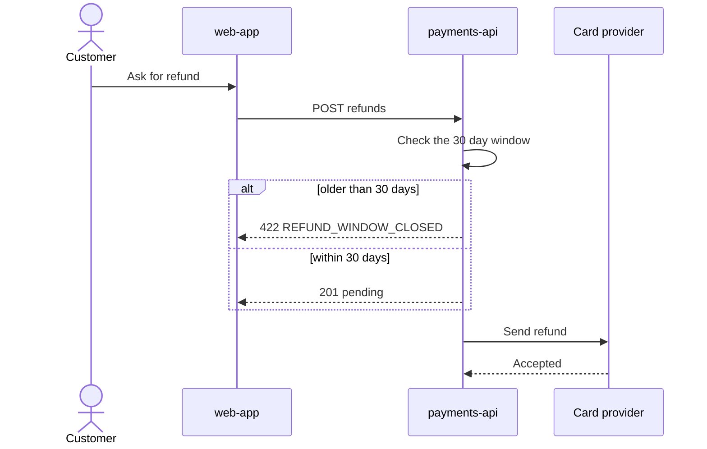

# Diagrams

Two diagrams carry the design. The feature map shows the whole feature at a glance. The
sequence diagram shows the main path in time, with the error paths.

## The feature map (design/feature-map.json)

It is a C4 "dynamic" view: the boxes show what exists, and the numbers show the order things
happen. Anyone can follow the numbers and understand the whole feature.

- **Everything is on it.** Every repo, table, event and outside system the feature uses. If
  the design mentions it, the map shows it.
- **One group per repo.** The script groups boxes by `repo`, so each team sees its part.
- **Status.** `new` (green), `changed` (amber), `same` (white, for context, taken from the
  system map, so it is real), `external` (dashed, outside the system).
- **At most 12 boxes**, actors included. More than that: group parts into one box.
- **Number the main story 1, 2, 3 in time order.** A second story continues the numbers.
- **say** is 2 to 6 words on the arrow: "POST refunds", "saves as pending".
- **line** is one plain sentence under the map: "The API checks the 30 day window and saves
  the refund as pending."
- **stories** on every step: the story or AC ids it serves.
- **kind** on every step decides its failure questions (see SCHEMA.md).

Do not write Mermaid for the feature map. The script draws it the same way every time.

## The sequence diagram (section 5)

Write it yourself as a Mermaid `sequenceDiagram`.

- Use the same names as the feature map.
- Show the main path and the 1 to 3 error paths that matter most, from the failure answers.
- Short message text, plain words.

## Mermaid rules that never break

- Participant and node ids: letters, numbers and `_` only.
- Labels in plain words. No `( ) [ ] { } " / | # ;` inside a label.
- No styling. The script styles the feature map.
- At most 4 diagrams in design.md, the feature map included.
